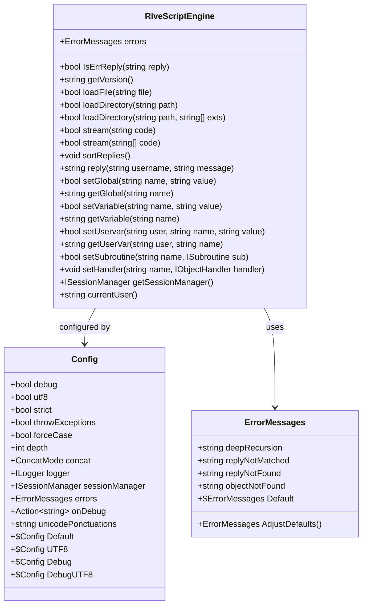
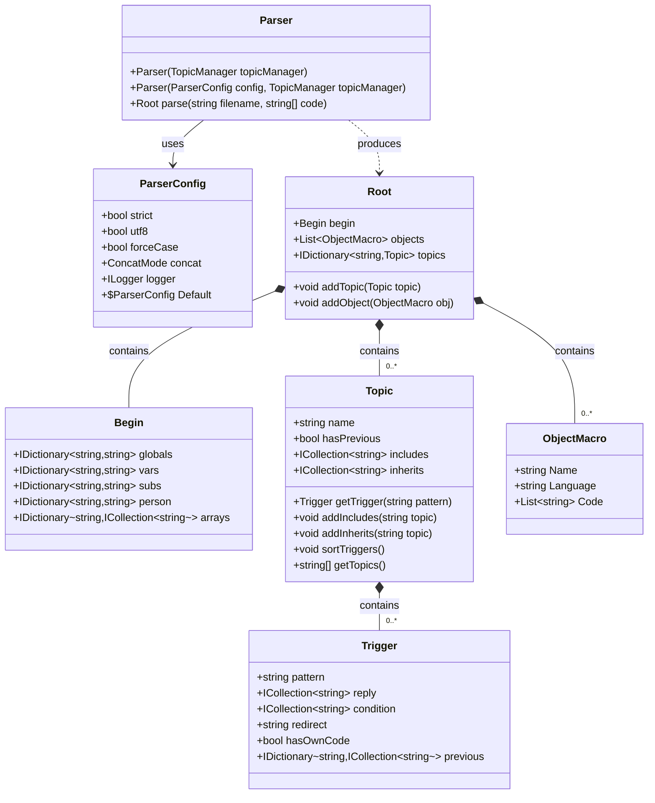
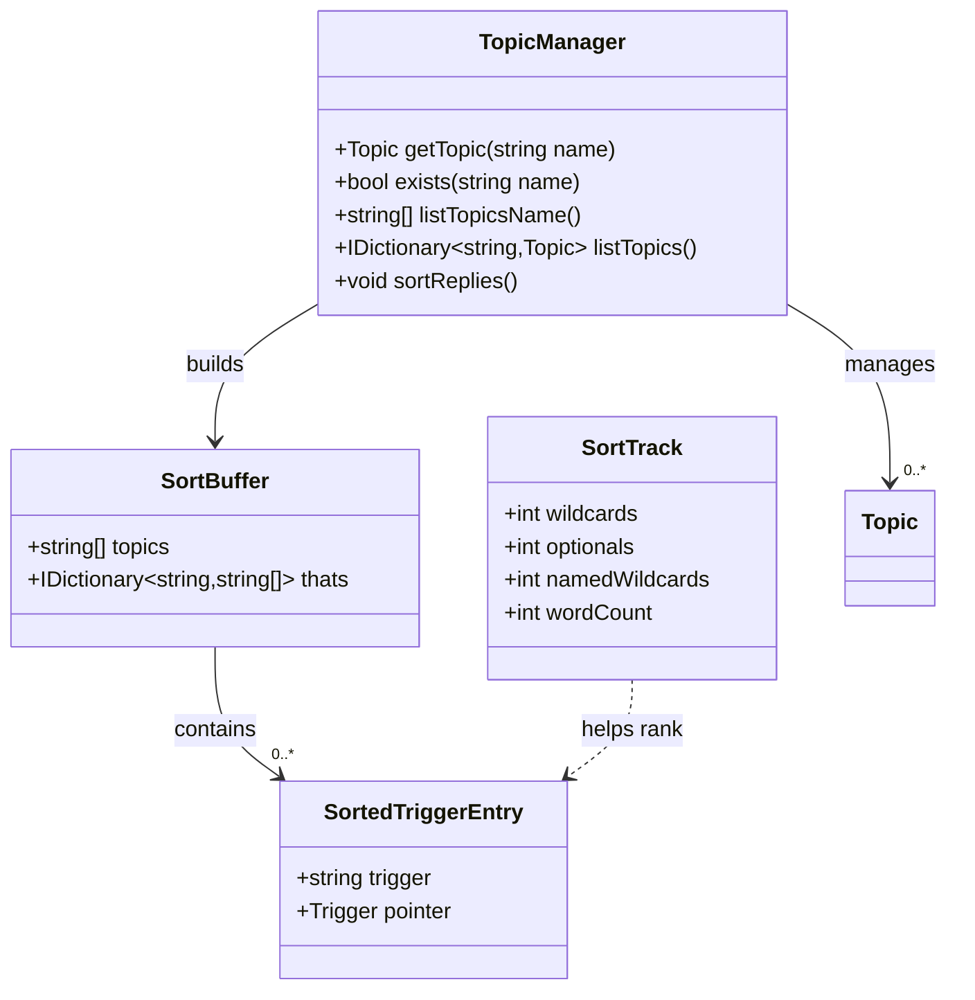
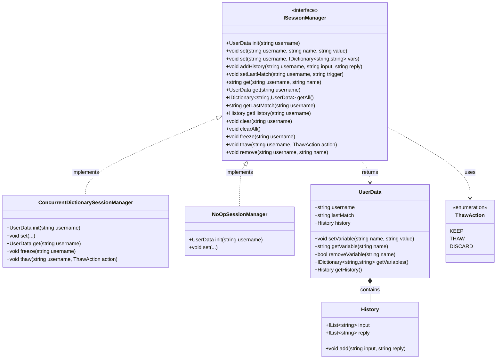
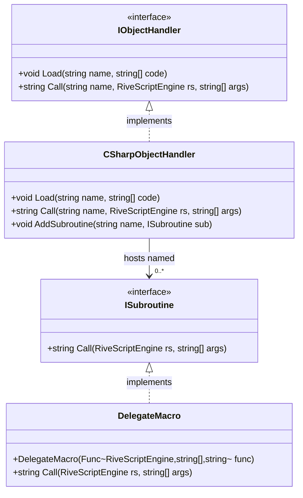
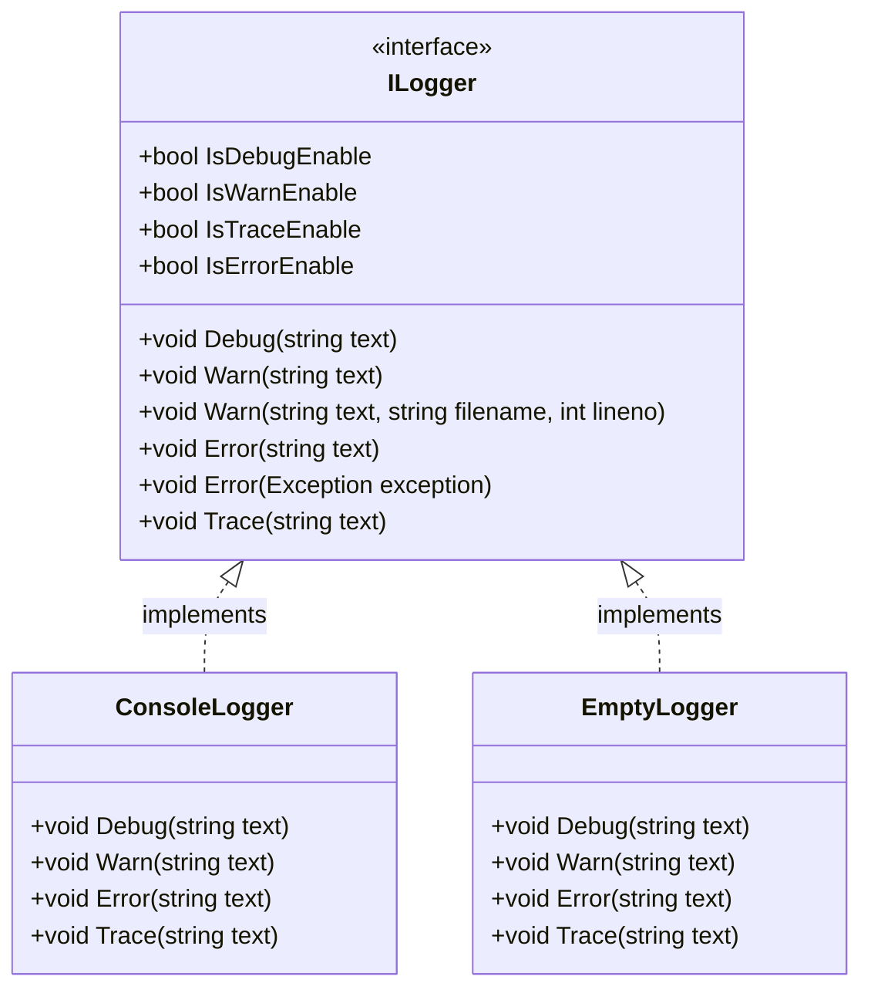

# C4 Level 4 — Code

The Code (class) diagram shows the key classes, their public members, and relationships inside the **RiveScript C# library**.

> Only the most important public members are shown for clarity.

---

## Core Classes

---

## Parser & AST

---

## Topic Manager & Sorting

---

## Session Management

---

## Object Handlers & Macros

---

## Logging

---

[← Component Diagram](c4-component.md) | [Architecture Overview ↑](index.md)
